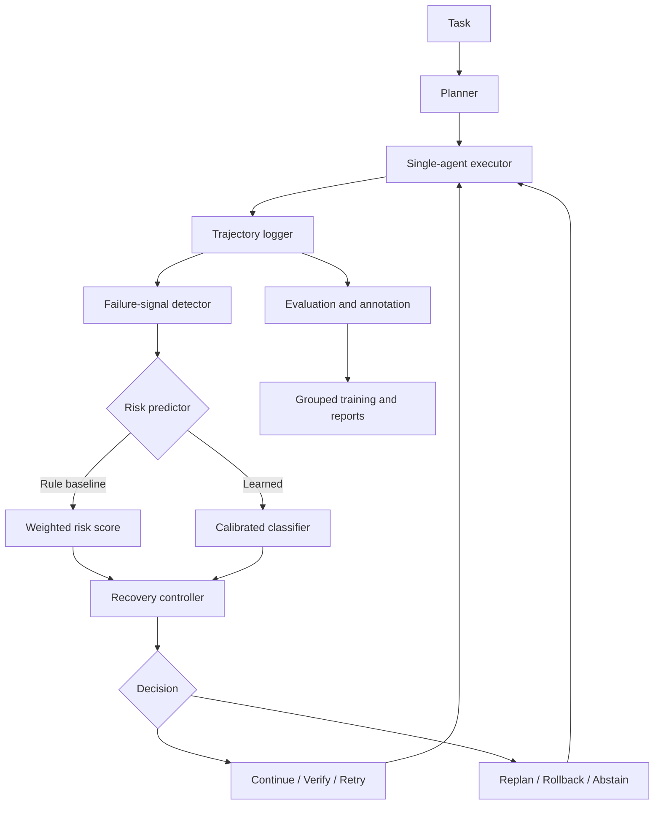

# ForesightAgent architecture

The executor owns task state while monitoring, prediction, and recovery are replaceable modules. Trajectories are serialized through a validated JSONL/CSV schema. Task-group splits prevent the same task identity from appearing in training and held-out evaluation.
